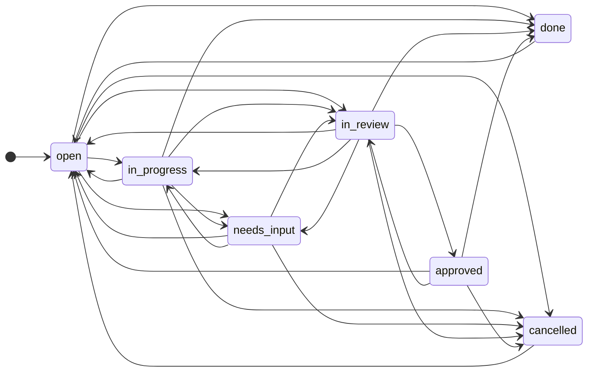

# Concepts

The vocabulary the rest of the docs use. [The Plan](PLAN.md) has the full data model and the reasoning.

## Tasks and statuses

A task belongs to one project and has a key like `DEMO-1`. Its status is one of `open`, `in_progress`, `needs_input`, `in_review`, `approved`, `done` and `cancelled`, with transitions enforced in the engine. "Blocked" is computed from dependencies, never stored.

The arrows are every move the engine allows (`Status::can_transition_to`); anything else is rejected. A closed task (`done` or `cancelled`) can only be reopened, and only `in_review` leads to `approved`. Only `in_progress` and `needs_input` keep a claim: a move to any other status, `open` included, releases it.

- `in_review`: an agent finished and someone must approve it.
- `approved`: a reviewer cleared it and it waits to be finished. For the factory, that means waiting to merge. Whoever finishes it moves it to `done`.
- `needs_input`: a question is open and the task is out of the ready queue.

## Claims and leases

Claiming a task is one atomic statement, so two agents can never hold it. An agent's claim is a lease (30 minutes by default) that it renews; if it crashes, the task frees itself. A human's claim doesn't expire.

## Handoffs

Comments have a kind: `handoff`, `progress`, `question`, `decision`, `review` and `note`. A handoff says what was done, what's left and what to watch for, and the next agent to claim the task gets the latest one.

## Questions

A `question` comment addressed to a human or an agent moves the task to `needs_input` until someone answers it. The factory parks a task this way when it needs a person.

## Review and delegated reviewers

A project can require review: agents then can't mark work `done`, only a person can. A human may list agents as the project's reviewers; they can approve `in_review` work like a human, except what they did themselves. Agents can turn review on but never off. A `review` comment records a typed verdict (approve or request changes) without moving the task.

## The event log, undo and revert

Every write is an event with before and after snapshots. `trailhead undo` undoes your last batch, and `trailhead revert` undoes what an agent did since a time. Anything changed afterwards by someone else is skipped and reported. Undo works for 90 days.

## Grades

A task can carry a grade from 1 (docs, tests) to 4 (auth, secrets, CI), for how much risk its work carries. A human sets the first grade; an agent can only raise it. The factory only works graded tasks, and the grade decides which checks and reviews a change needs before it merges ([grades](factory/review.md#grades)).
