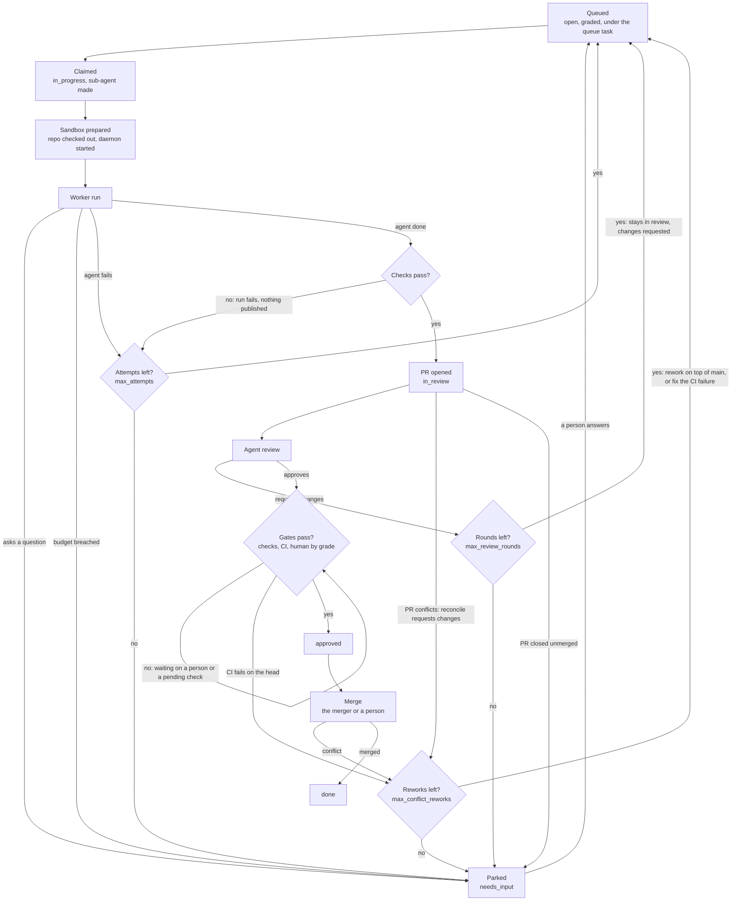

# Task lifecycle

> How one task moves through the factory, from queued spec to merged PR. Next: [Operating](operating.md) to run it, [Review](review.md) for grades, gates and the merger.

Proposal: the factory's lifecycle is Trailhead's existing one plus conventions, with a few engine changes ([engine-changes.md](engine-changes.md)). One sandbox per task, created when the task starts running and destroyed when it's done.

## Trailhead today

Statuses: `open`, `in_progress`, `needs_input`, `in_review`, `approved`, `done`, `cancelled`, with `approved` between `in_review` and `done`. Claims are leases (agents 30 minutes by default, renewed by heartbeat; human claims don't expire). Moving a task to `in_review`, `approved`, `done` or `cancelled` releases its claim; `in_progress` and `needs_input` keep it. Delegated reviewers, agents a human lists on a project, can approve `in_review` → `approved` or `done`.

## The flow for one task

The loops back to `queued` start a fresh sandbox from the PR branch. The task never goes back to `open` for them: it stays `in_review` with changes requested (below), so it stays out of the backlog while its PR is open. A conflict rework doesn't use a review round (it has `max_conflict_reworks`). The [merger](review.md#the-merger) page has the detail of the gates and the merge.

A rework (a review's changes, a failed CI, a conflict) whose `setup` check fails while its sandbox is prepared does not count as an infrastructure failure: the branch is what is broken (CI red from a merged main, say), and the worker is the one who can fix it. The sandbox is kept, prepared again without `setup`, and the agent starts with the `setup` output after the review's feedback. A fresh attempt on the base branch whose `setup` fails is still an infrastructure failure, but its sandbox is released, not destroyed as broken, since the same error would come from any other: one that was idle in the pool is restored to its warm checkpoint and returns to it, while a newly created one has no checkpoint yet (it is taken after a good prepare) and is destroyed by the release. A sandbox is destroyed on a failed prepare only when it is itself broken, such as a checkout that cannot be reset.

## Mapping

| Factory step | Trailhead | Fit |
| --- | --- | --- |
| Spec | Parent task; `description` is the editable spec, comments are history | Fits |
| Approved | Human moves the spec task to `done` (project with `require_review`) | Fits, by convention |
| Planned | Planner creates subtasks with `parent_id`, `blocked_by` the spec task | Fits |
| Queued | `open`, graded, under the queue task; ready queue; repo cap enforced by the control plane; ordered by priority (raised to the highest open task it blocks), then reworks of open PRs before fresh tasks, then due date and age, as [Handing it work](operating.md#handing-it-work) says | Fits once tasks have grades |
| Running | Claim + `in_progress`; the daemon renews the lease | Fits |
| PR open / Review | `in_review`; PR URL, grade, profile in `metadata` | Fits, but the claim is released |
| Agent review verdict | One delegated reviewer approves straight to `done` | Gap: no verdict record, no quorum |
| Changes requested | Stays `in_review`; computed from the newest `review` verdict being `request_changes` with no `handoff` after it (TRAIL-963); the review is also kept in `metadata` for the prompt | Fits; the rework starts a fresh sandbox, not the original one. `Tracker::ready` lists these tasks ahead of new work, the worker's claim makes the task `in_progress`, and the handoff it leaves when it pushes answers the review |
| Approved | `approved`: the grade's gates passed, waiting to merge | `approved` exists (TRAIL-86) |
| Merging | The merger or a person merges; `done` means merged | Fits |
| Parked | `ask` → `needs_input` | Fits, but the agent lease expires while parked and an answer sends it back to `open` |
| Done / Cancelled | `done`, `cancelled` | Fits |
| Spend, budget | `metadata` JSON, filterable by key | Fits, by convention |

## Conventions

- **Sandbox per task, capped per repo.** No file locking; overlapping work is resolved through PRs and merge conflicts, which go through the same gates. A merge conflict sends the task back to Running. Reconcile checks the PR of each in-review task, and each approved one, with one `CodeHost::pr_state` call (a merge finishes the task, approved or not, unless core refuses the factory's `done`, which parks it for a person to mark it done, as under Merger; a closed PR parks either; a newly conflicting PR is sent back for a conflict rework, as below), and also those of open tasks waiting for a rework (a merge finishes them; a closed PR parks them) and parked `needs_input` tasks (only a merge finishes them; an open or closed PR leaves them parked) (TRAIL-323). The call also says whether it merges cleanly (`PrState::Open { mergeable }`); one GitHub reports as conflicting (TRAIL-199) is reopened for a rework like a request for changes (an approved task is unapproved first, so shadow mode and grades that don't auto-merge notice when `main` moves too; TRAIL-299), except the checkout has the base branch merged in, uncommitted, for the worker to resolve. The result is published as a merge commit (`Commit::merges`), checked, and reviewed again. Before any review, the control plane asks the host a few times, over about ten seconds, whether the PR it just pushed merges cleanly. A conflict reported for the new head means `main` moved during the run, so the task goes straight back for another conflict rework rather than spending a reviewer on it (TRAIL-844). The host works `mergeable` out after a push, so a reading right after a rework's push may still be the old head's: `PrState::Open` carries the head too, the head from before a conflict or CI rework is recorded as `stale_head` in the run's `factory` metadata, readings for that head (or null ones) are ignored, and the first answer for another head clears the mark, so a head that moves on can't leave it stuck (TRAIL-446). A request whose head the host couldn't report leaves no mark. A conflict sent back this way counts as a conflict rework, not a review round (TRAIL-221): the count is `conflict_reworks` in the `factory` metadata, a PR that keeps conflicting parks for a person at `max_conflict_reworks` (`[factory.repo]`, default 5), and the review after a conflict rework doesn't use a round either, though one that asks for changes does. A review asking for changes doesn't reset the conflict count. A conflict rework the factory asked for whose conflict the host no longer reports when the run is about to start (the base moved back, or someone fixed it) runs no worker: the request is dropped, the conflict count is reset, and the task goes back to review, so it never fails as "changed nothing" and uses up an attempt (TRAIL-243). A CI failure rework still merges the base in whatever the host says.
- **Suspend during review.** The sandbox hibernates while waiting, so requested changes resume with context. Needs resume affinity; until then (and in the MVP), requested changes start a fresh sandbox from the PR branch. The control plane records the review (reviewer and body) in the task's `factory` metadata and leaves the task `in_review`, now with changes requested (a conflict or CI rework gets a `request_changes` review comment from the factory, as a reviewer's has); the next run checks out `origin/<branch>`, is resumed with the review as feedback, publishes on top of the PR head and pushes to the same PR. Review rounds count across reworks; when round `max_review_rounds` (default 3) still asks for changes, the task is parked as `needs_input` with the last review in the question. `max_attempts` counts failed runs since the last review that asked for changes, so reworks get attempts of their own. The review is marked done in the same write that records it, and a reconcile that finds a request in the metadata with no `request_changes` review behind it (the control plane stopped before recording it) finishes the request or the park. A request that no longer applies, because a person pushed to the PR or settled the park, is answered with a handoff and the PR is reviewed as it stands. A rework that fails and is given back, or whose lease lapses, returns to `in_review` with the changes still requested. A review an approval has since superseded is not passed to later runs. A check that passed only on rerun during a rework is posted as a PR comment, since the PR body was written when it opened.
- **Verdicts live in Trailhead, not GitHub reviews.** Sandboxes act on GitHub as the user who authorized the connector, and GitHub doesn't let a PR's author approve it (inferred, untested). Agent reviews post as PR comments.
- **Merger.** On factory projects the only delegated reviewer is the control plane's own identity, acting as the merger ([review.md](review.md#the-merger)). Reviewer agents record typed `review` verdicts; they don't move the task. The merger moves it to `approved` once the grade's gates pass, which for grades above Treeline includes a person approving, and to `done` after the PR merges, whether it merged the PR or a person did. A person merging the PR settles it: the task is finished even if nobody approved it (still in review, waiting for a rework, or parked `needs_input`), with the merge recorded as `human` (TRAIL-1438). Core refuses that `done` in two cases, both for a task still in review: the factory isn't one of the project's reviewers (TRAIL-1439), or its own identity sent the work to review, as after a conflict that went away. The merge is still recorded (TRAIL-706), and the task is parked `needs_input` with one question asking a person to mark it done; reconcile skips it from then on. Both go through one function, `Factory::close_merged` (TRAIL-198): reconcile calls it for a merge made outside the factory (`PrState::Merged` from `CodeHost::pr_state`), and the merger calls it right after `CodeHost::merge` (`[factory.merge] mode = "on"`, TRAIL-205), so auto-merge adds the merge call and the gate check, not a second way to finish tasks. It records who merged (`human` or `merger`), the PR and the merge commit in the task's `factory` metadata and in the handoff, which for the merger also names the grade and the gates that passed. A merge conflict at merge time sends the task back to running for a rework, and without delegated-reviewer rights the merger only behaves as in shadow mode. A PR closed without merging parks the task with a question for a person rather than reopening it, since a rework would push to a PR nobody will merge. Other agents can't approve or finish factory tasks. A person adds the factory's identity to the project's reviewers once; only a human can.
- **Who can write task metadata.** Agents can't edit a task another actor holds, so the daemon writes its own run metadata as the claim holder. If the control plane needs to write it, Trailhead must let a parent agent act on tasks its sub-agents hold.

## Explicit phases (design, TRAIL-1455)

Agreed 2026-11-12 and being built in the steps under Order. It changes how the control plane names what it already does, not what it does.

### The problem

A factory task's state is its Trailhead `status` plus about 35 optional fields in its `factory` metadata (`RunUpdate`). The real states (a run interrupted, a park cut short, a review owed, a rework waiting for a worker) exist only as conditions spread over `reconcile.rs`, `lifecycle.rs`, `review.rs` and `merger.rs`. `reconcile_task` is about 160 lines of them. Each fix adds a field or a condition, and nothing lists the states, so nothing says when two conditions overlap or a case is missing. 59% of this repo's commits have been in the control plane, and 36% of all commits are fixes.

### What is proposed

**1. A `Phase` enum, computed, never stored.** `phase(task, me) -> Phase` is a pure function of the task record (`status`, `holder`, the run fields) and the control plane's own agent name. It is the one place that says which state a task is in. Nothing new is persisted, so there is no migration and a task written by today's build reads the same.

| Phase | Today's condition | What reconcile does |
| --- | --- | --- |
| `Untouched` | No `sandbox` in the run fields | Nothing: the queue's business |
| `ReviewBreachUnparked` | A reviewer breach for this attempt, not parked; task `open`, or `in_progress` held by the factory | Finishes the park |
| `WorkerBreachUnparked` | A worker breach, not parked; `in_progress` under the run that breached | Finishes the park |
| `Running` | `in_progress` under the current run's sub-agent, report not handled | Follows the run if its sandbox is still busy, else requeues |
| `Interrupted` | `in_progress` otherwise | Releases and requeues |
| `Requeued` | `open` with a run | Settles a merged or closed PR, else leaves it to the queue |
| `Parked(why)` | `needs_input`: `MergedUnapproved`, `RequestUnsettled`, or `Asked` | Finishes a merge, settles the request, or waits |
| `ReworkWaiting(kind)` | `in_review`, changes requested, the request still applies | Leaves it to the queue |
| `ReworkStale` | `in_review`, changes requested, but the request is settled or the PR moved | Answers the request, looks at the PR as it is |
| `RequestCutShort(kind)` | `in_review`, a pending request never recorded as a review | Records it |
| `ReviewOwed` | `in_review`, the attempt's PR not reviewed (or pushed to since) | Starts a review once any backoff is over |
| `AwaitingGates` | `in_review`, reviewed | Evaluates the gates |
| `Approved` | `approved` | Checks for a conflict, evaluates the gates |
| `Closed` | `done`, `cancelled` | Nothing |

Two things the record can't say stay inputs to reconcile, beside the phase: what the code host says of the PR (open, merged, closed, mergeable, its head), and whether the run's sandbox is still busy. `ReworkStale` and `ReviewOwed` each need the PR's head, so `phase` returns the candidate and reconcile confirms it against the host, as it does now.

**2. `reconcile_task` becomes a `match` on `Phase`**, one arm per row, each arm a function. No behaviour changes; the lifecycle suite, which since TRAIL-1435 drives the production start path, is the check.

**3. A request kind.** A changes request is a review's, a conflict's or CI's. Today that is `conflict: bool` plus `reviewer == "CI"`, read at nine sites. It becomes `kind: Review | Conflict | Ci` on `ChangesRequested`. The two old fields are no longer written. A record from before has no `kind`, so for a task already in flight it is read from `conflict` and `reviewer`.

**4. Clears that say so.** A write merges, so a field is cleared today by writing a stand-in: an empty string for `merging` and `stale_head`, zero for `released` and `gave_up`. The stored metadata is merged as a JSON merge patch, where `null` already removes a key. The proposal is to split the one struct in two: `Run` (what is read: plain optional fields) and `RunPatch` (what is written: each field `Keep`, `Clear` or `Set`). `Clear` writes `null`. Reads treat the old stand-ins as absent, so existing records need no rewrite.

**5. Usage-pause readings on disk.** The subscription usage readings that pause new runs are held in memory only, so a restart forgets a pause until the next reading. They go in a file beside the spend ledger and are reloaded at start. The claim that the control plane "keeps no state" is corrected for what stays in memory (backoff deadlines, setup-failure counts), which a restart may safely forget.

**6. `Factory`'s fields in their groups.** Its 21 mutex-guarded maps become four structs they already form (pool, merger, backoff, placement), done as the long functions are split, not as one change.

### Order

Each step is one PR that leaves the suite green: the `Phase` enum and `phase()` with unit tests built from the cases `reconcile_task` handles, called by nothing; then the dispatch; then 3, 4 and 5, which are independent of each other; then 6 alongside whatever function is being split.

### Not proposed

Storing the phase, changing any status transition, or changing what a person sees in Trailhead. Lookout showing the phase is a later choice, not part of this.
